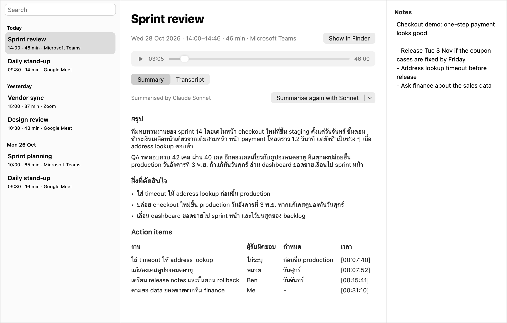

<div align="center">

# Minutes

### Your meetings, remembered.

Record the conversation. Find the decisions. Follow through.

[Download](#download) · [Install](#install) · [User guide](docs/MACOS_GUIDE.md) · [Contribute](CONTRIBUTING.md)

</div>



Minutes turns calls and room conversations into searchable transcripts, summaries and action items in Thai or English. Transcription runs on your computer. Choose the AI provider that writes your summaries, and keep the recording, notes and transcript together in your own workspace.

## From conversation to follow-through

| Record | Understand | Revisit |
|---|---|---|
| Capture meeting audio, or add the meeting window with screen recording. | Transcribe locally, then generate a summary with decisions and action items. | Search your meetings, replay a timestamp and keep notes beside the discussion. |

- **Local transcription.** Speech recognition uses whisper.cpp on your computer. No summary-provider account is needed to record or transcribe.
- **Your choice of AI.** Summarise with Claude Code, Codex, Ollama or Gemini through Antigravity (`agy`).
- **A record you can work with.** Organise meetings, review transcripts and export useful notes instead of starting from a blank page.
- **Thai and English.** Set the spoken language and choose the language of your summary.

> The screenshot and detailed interface guide show macOS. Windows is a newer port with [documented feature gaps](windows/docs/PARITY.md).

## Download

| Platform | Requirements | Available download |
|---|---|---|
| **Windows** | Windows 10 build 19041+ or Windows 11 · x64 | [**Download 1.0.0 ZIP →**](https://github.com/chanpollo/minutes/releases/download/v1.0.0/Minutes-1.0.0-win-x64.zip) |
| **macOS** | macOS 14.2+ · Apple silicon or Intel | [**Download 1.0.0 DMG →**](https://github.com/chanpollo/minutes/releases/download/v1.0.0/Minutes-1.0.0.dmg) |

Both desktop downloads are available in [Release 1.0.0](https://github.com/chanpollo/minutes/releases/tag/v1.0.0). iPhone and iPad apps are not available.

**Windows release status:** 1.0.0 is available, but recording, calendar, sign-in and sync still need validation on a real Windows PC. Review the [PC testing checklist](windows/docs/TESTING.md) before relying on it for a meeting. Windows ARM and 32-bit downloads are not provided.

## Install

### Windows installation

1. Download [Minutes-1.0.0-win-x64.zip](https://github.com/chanpollo/minutes/releases/download/v1.0.0/Minutes-1.0.0-win-x64.zip).
2. Right-click the ZIP and choose **Extract All**. Keep the entire extracted folder together; do not run the app inside the ZIP or move only the executable.
3. Open the extracted folder and run **Minutes.App.exe**. This is a portable app, so there is no setup wizard. The download includes its .NET runtime.
4. The app is unsigned, so Windows may show a security warning. Verify that the download came from this repository. On a managed PC, follow your organisation's installation policy.
5. Allow microphone access when prompted and wait for the speech models to download. If needed, retry with **Download Speech Models** in Settings.
6. To generate summaries, install and sign in to your chosen summary-provider CLI. Recording and transcription work without one. Google Drive integration needs your own OAuth credentials.

Requires Windows 10 version 2004 (build 19041) or later, or Windows 11, on x64. Capturing a specific app's audio requires build 20348 or later; earlier supported builds fall back to whole-system audio. Windows ARM and 32-bit builds are not provided.

### macOS installation

**You need:** a Mac running macOS 14.2 or later. The same download works on Apple silicon and Intel. No Xcode or Homebrew is required.

1. **Download** [Minutes-1.0.0.dmg](https://github.com/chanpollo/minutes/releases/download/v1.0.0/Minutes-1.0.0.dmg).
2. **Install:** double-click the downloaded DMG, then drag **Minutes** onto **Applications** in the window. Wait for the copy to finish.
3. **Open:** go to **Finder → Applications** and double-click **Minutes**. You can now eject the Minutes disk image.
4. **Allow access:** approve microphone and audio capture when asked. Approve screen recording if you want video, and calendar access if you want meeting titles from your calendar.
5. **Finish setup:** stay connected to the internet while Minutes downloads its speech models (about 610 MB). Once they are ready, make a short test recording.

**If macOS blocks the first launch**

The app is signed but is **not notarised by Apple**, so macOS may ask you to approve it:

1. Confirm you downloaded the DMG from this repository's release page, then try opening Minutes once.
2. Open **System Settings → Privacy & Security**.
3. Find the message about Minutes and choose **Open Anyway**, then confirm **Open**. Your Mac may ask for authentication.

If **Open Anyway** is unavailable on a managed Mac, contact your IT administrator. A warning that the app will damage your computer is different; do not bypass that warning.

**Ready to record?** Recording and transcription need no AI account. For summaries, install your preferred provider separately and use **Settings → Summary → Sign In…** for supported tools that need sign-in. If models fail to download, choose **Download Speech Models…** to retry.

### Your first meeting

1. Start a short test recording. On Mac, choose **Record Voice** for audio or **Record Screen** for audio and the meeting window.
2. Stop recording and wait for the transcript.
3. Review the transcript, then choose **Summarise** with your preferred provider.
4. Check the decisions and action items, add your own notes, and replay any passage you want to verify.

## Choose how summaries are made

| Provider | How it runs |
|---|---|
| **Claude Code** | Through your installed and signed-in Claude Code CLI. |
| **Codex** | Through your installed and signed-in Codex CLI. |
| **Ollama** | With a local model you have downloaded. |
| **Gemini** | Through Antigravity (`agy`) and its Google sign-in. |

Recording and transcription work without a summary provider. Provider tools are installed separately; using one may require its own account or subscription. See the [macOS settings guide](docs/MACOS_GUIDE.md#settings) for configuration and the [Windows guide](windows/README.md) for that port's setup.

## Your data and privacy

Transcription runs locally. Cloud summary providers receive the transcript when a summary is requested, including when automatic summaries are enabled. Ollama can keep summarisation local. Sync is optional and sends selected meeting files to the destination you configure.

On Mac, a meeting marked **confidential** is excluded from summaries and sync; see the [user guide](docs/MACOS_GUIDE.md#how-it-works) for details. Check the [Windows coverage record](windows/docs/PARITY.md) for platform differences. Use a short test meeting to check capture and permissions before recording an important call, and make sure participants know the meeting is being recorded.

## Explore the guides

| I want to… | Read |
|---|---|
| Learn recording, notes, playback and keyboard shortcuts | [macOS user guide](docs/MACOS_GUIDE.md) |
| Configure sync and understand meeting files | [Sync](docs/MACOS_GUIDE.md#sync) · [Meeting folder](docs/MACOS_GUIDE.md#meeting-folder) |
| Check Windows features and remaining work | [Windows feature coverage](windows/docs/PARITY.md) |
| Test Windows on a real PC | [Windows testing guide](windows/docs/TESTING.md) |
| See what changed | [Changelog](docs/CHANGELOG.md) |

## Build from source

For macOS, install the Swift toolchain on macOS 14.2 or later:

```sh
swift test
./build.sh
open build/Minutes.app
```

Recording and transcription also need speech tools and models. Follow the [full macOS setup](docs/MACOS_GUIDE.md#build-from-source) before using them. Build Windows on a Windows x64 machine using the [Windows developer guide](windows/README.md#build-on-windows-x64); portable core tests can run on macOS, Linux or Windows.

## Help make Minutes better

Found a bug, have an idea, or want to test on your machine? Start with an [issue](https://github.com/chanpollo/minutes/issues). Code, documentation and real-device testing contributions are welcome.

Read [CONTRIBUTING.md](CONTRIBUTING.md) for setup, validation and the **issue → pull request → review** process. Discuss larger changes before implementation, use synthetic meeting data in reports, and include what you tested in your PR.

Please follow the [community code of conduct](CODE_OF_CONDUCT.md). For a suspected vulnerability, use the [security reporting process](SECURITY.md) instead of posting technical details publicly.

## License

Minutes is licensed under the [MIT License](LICENSE). Third-party tools and dependencies retain their own licenses; see the [Windows third-party notices](windows/docs/THIRD-PARTY.md) and the license files included in the macOS app bundle.
