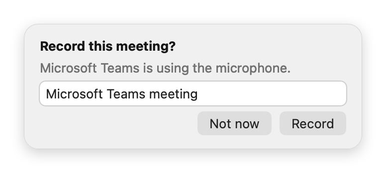
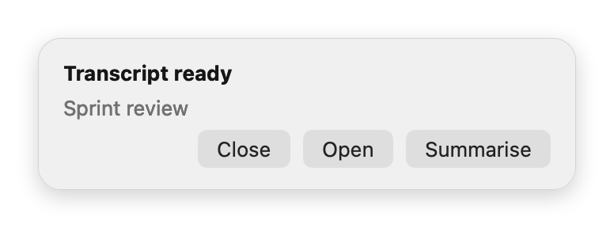

# Minutes

A macOS menu bar app that records your meetings, transcribes them on the Mac and summarises them on request with your Claude subscription.


## How it works

1. A call app (Teams, Meet in a browser, Zoom, FaceTime…) keeps the microphone open for a few seconds. Minutes asks whether to record and offers a title, which you can change.

   

2. While the call runs it records three things: your microphone (`me.wav`), everything the Mac plays (`others.wav`) and the meeting app's window. When the call releases the microphone for 30 seconds, recording stops by itself. You can also start and stop it from the menu.
3. The window video and both audio tracks become one `meeting.mp4`. The meeting then moves into your workspace folder as `yyyy-MM-dd HHmm Title/`, and whisper.cpp writes the transcript locally, with lines marked **Me** and **Others**.
4. Nothing is summarised until you press **Summarise**, either on the "Transcript ready" card or in the notes window. The summary is written in Thai, with decisions and action items (owner, due date, and the moment in the call).

   

5. If Google Drive is connected, each meeting is uploaded to `Minutes/<meeting folder>` in your Drive. Notes, summaries and renames are uploaded too.

## Notes window

**Open Minutes** (⌘O in the menu) lists the meetings in the workspace by day and searches titles and transcripts. Each meeting is a page:

- **Title:** click it to edit. Renaming also renames the folder.
- **Player:** plays `meeting.mp4`, or both audio tracks when there is no video.
- **Summary:** shows `summary.md`. **Summarise** uses the selected model; its menu switches between Sonnet (default), Opus and Haiku.
- **Transcript:** click a line to play from that moment.
- **Notes:** saved to `notes.md` as you type.


## Requirements

- macOS 14.2 or later and the Swift toolchain (Xcode or the Command Line Tools).
- [Homebrew](https://brew.sh), for whisper.cpp.
- [Claude Code](https://claude.com/claude-code), signed in, for summaries. It is called as `claude -p` with no tools, MCP servers or settings, so the summary run can only read the transcript it is given.
- Optional: a Google Cloud OAuth client for Drive upload (see below).

## Install

```sh
./setup.sh            # whisper-cli and the speech + VAD models (~575 MB)
./build.sh install    # builds and copies Minutes.app to ~/Applications
open ~/Applications/Minutes.app
```

macOS asks for three permissions: **Microphone**, **System Audio Recording** and **Screen Recording**. Without Screen Recording, meetings are recorded as audio only.

`build.sh` signs with your Apple Development certificate if you have one. A stable signature keeps those permissions across rebuilds; ad-hoc builds may ask again.

## Menu

| Item | What it does |
|---|---|
| Record Now / Stop Recording | Manual start and stop. A manual recording records the main display, because no call app is known. |
| Open Minutes | The notes window. |
| Summarise Last Meeting | Summarises the newest meeting that has a transcript. |
| Summary Model | Sonnet, Opus or Haiku. |
| Record Screen | Switches video capture on or off. |
| Workspace | Shows the meetings folder, lets you choose another one, opens it in Finder. |
| Google Drive | Connect, Upload Now, Disconnect, and the OAuth client. |
| Open at Login | Starts Minutes when you log in. |

If you quit while recording or transcribing, Minutes asks first. The unfinished meeting is picked up on the next launch.

## Meeting folder

```
2026-10-28 1400 Sprint review/
  meta.json        id, title, start and end, app, video offset, summary model, Drive file ids
  me.wav           your microphone, 16 kHz mono
  others.wav       everything the Mac played, 16 kHz mono
  meeting.mp4      meeting window (HEVC, 15 fps) + both tracks mixed (AAC)
  transcript.md    **[hh:mm:ss] Me:** … / **[hh:mm:ss] Others:** …
  summary.md       only after Summarise
  notes.md         only after you type notes
```

The files are plain, so Finder, Obsidian or a script can read them. Recordings are written to `~/Library/Application Support/Minutes/Recording` first and moved into the workspace only when they are complete. That way a synced folder never sees half-written files.

## Google Drive

Minutes uploads the files itself, so Google Drive for Desktop is not needed. It asks only for `drive.file`, which means it can see only the files it created.

1. In [Google Cloud Console](https://console.cloud.google.com), create a project and enable the **Google Drive API**.
2. Under **OAuth consent screen**, choose External and add your own Google account as a test user.
3. Under **Credentials**, create an **OAuth client ID** of type **Desktop app**.
4. In Minutes, choose **Google Drive › Connect…**, paste the client ID and secret, then sign in in the browser.

The sign-in returns to a listener on `127.0.0.1` on a random port. The refresh token is kept in the macOS Keychain.

Drive receives `meeting.mp4` (or the two WAVs when there is no video), `transcript.md`, `summary.md` and `notes.md`. `meta.json` stays on the Mac.

## Command line

```sh
MINUTES=~/Applications/Minutes.app/Contents/MacOS/Minutes
$MINUTES --transcribe "<meeting folder>"
$MINUTES --summarize "<meeting folder>" --model opus
```

## Settings without a UI

```sh
# when claude is not found automatically
defaults write com.enta1234.minutes claudePath /path/to/claude
```

Minutes looks for `claude` in `~/.local/bin`, `/opt/homebrew/bin`, `/usr/local/bin`, `~/.claude/local` and the newest `~/.nvm/versions/node/*/bin`.

## Limits

- The other participants are not told that the call is being recorded. Tell them.
- "Others" is everyone on the call. Speakers are not separated yet.
- The meeting window is chosen when recording starts. If the call moves to another window, the video does not follow.

Plans and open points are in [docs/PLAN.md](docs/PLAN.md).
