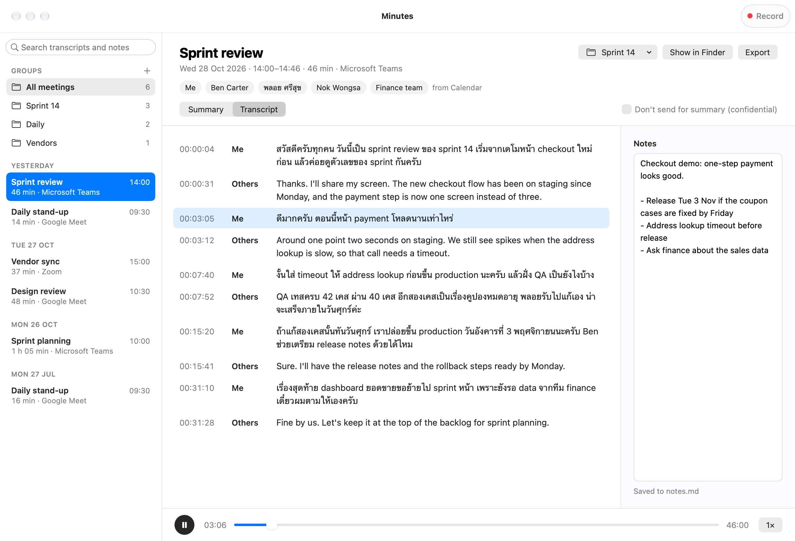

# Minutes

A macOS app (Dock and menu bar) that records your meetings, transcribes them on the Mac and summarises them with Claude Code, Codex, a local Ollama model or Gemini through agy, whichever you pick.


## How it works

1. A call app (Teams, Meet in a browser, Zoom, FaceTime…) keeps the microphone open for a few seconds. Minutes asks whether to record and offers a title, which you can change. The title is the calendar event that is on now, or "<App> meeting" when there is none. Other apps that use the microphone, such as dictation or a voice memo, are not asked about unless you add them in **Settings › Recording**. Pick **Screen** or **Voice** above the title; the red button reads **Record Screen** or **Record Voice**, and the pick is kept for that app. Tick **Always record <App>** and that app is recorded without asking next time, in its kept mode; a small card says so and offers **Stop**. **Not now** holds while the app keeps the microphone, until a calendar meeting with its call link starts or 15 minutes pass. Stopping a recording is not Not now: when the app still holds the microphone, as when one Teams meeting runs into the next, the card comes back, and it asks even for an app recorded without asking. Pressing **⌃⌥R**, the window's Record button or a Record item in a menu while the card is up records that card's call: its window, its title and its stop when the call ends.

   

2. **Screen** records three things: your microphone (`me.wav`), everything the Mac plays (`others.wav`) and the meeting app's window. **Voice** records the microphone and Mac audio only, with no screen and no Screen Recording request; the microphone may carry several people. The mode is chosen before recording starts and stays until it stops. When the call releases the microphone, a **Stop recording?** card comes up after 3 seconds and recording stops by itself after 30 (Settings › Recording › Stop automatically). If the app takes the microphone back while that card is up, as when you join the next call straight after hanging up, a card asks whether it is a **New Meeting** (the recording stops and the call is offered as a meeting of its own) or the **Same Meeting**; left unanswered, a calendar meeting for the app that began during the recording means a new one. After **Keep Recording**, a call that then ends without taking the microphone back still stops, once the app has also played no sound for the same 30 seconds; an app whose sound is not reported keeps recording until you stop it. **Mute Microphone**, on the recording page and in the menu bar menu, records silence on the microphone track until you turn it off, for talk aside while you are muted on the call: Minutes does not see a call app's own mute. **⌃⌥R** starts or stops a recording from any app, in the mode set under **Shortcut and Record button use**; **Record Screen** and **Record Voice** in the menu bar menu, the Dock menu and under the window's Record button start that mode and make it the default.
3. The window video and both audio tracks become one `meeting.mp4`; when the window video started a moment after the sound, its first frame is shown from the start. Videos made before that show the first frame there too. The meeting then moves into your workspace folder as `yyyy-MM-dd HHmm Title/`, and whisper.cpp writes the transcript locally, in the language set under **Settings › Recording › Spoken language** (Thai on a Mac with Thai among its languages, else detected; detection picks the wrong language on quiet or mixed audio), with lines marked **Me** and **Others**. When more than one voice is heard on the call side, sherpa-onnx tells them apart and the lines read **Speaker 1**, **Speaker 2**… instead of **Others**; voices with under 20 seconds of speech (or under 5 % of the track's, whichever is less) are folded into the nearest one. In a Voice recording started by hand, with no call app, the microphone is separated too; the numbers run across both tracks in the order the voices are first heard, and a track with one voice keeps **Me** or **Others**. In a call the microphone is always **Me**, and a Me line that only repeats what Others said at the same moment (the speaker heard by the microphone) is dropped. A phrase whisper repeats three times or more, inside a line or across nearby lines, is cut to one and the stretch decoded again; in a call, what that second pass hears on the microphone while the call side is speaking is taken as the call side and left out of Me. With Speakers off, every microphone line reads **Me**. The two tracks are then compressed to FLAC without loss.
4. Nothing is summarised until you press **Summarise**, on the "Transcript ready" card or in the notes window, unless **Summarise automatically** is on. The summary is written in Thai (or English, or the meeting's language), with decisions and action items (owner, due date, and the moment in the call). For a Voice meeting the prompt tells Claude that the microphone may carry several people and that the Speaker labels include the person who recorded. **Listen** on the summary then makes a short spoken briefing of it on the Mac (see [Audio briefing](#audio-briefing)).

   

5. With **Settings › Sync** on, each meeting is copied to `Minutes/<group>/<meeting folder>` (`Minutes/<meeting folder>` when it has no group) in a folder that Google Drive, iCloud Drive, OneDrive or Dropbox uploads, or uploaded to Google Drive by Minutes itself. Notes, summaries, renames and moves between groups follow.

A meeting marked **confidential** is not sent for summary and not synced; marking it after it was synced removes its copy. With **Settings › Summary › Mark meetings with external attendees as confidential** (on by default), a new meeting is marked when the calendar event has an invitee whose email is on another domain than yours.

## Notes window

**Open Minutes** (⌘O in the menu, or the Dock icon) shows the meetings in the workspace. The window opens at 1440 × 860 pt and can be made as small as 960 × 560. **Record Screen** (or **Record Voice**, after the default mode) at the top right starts a recording, the chevron beside it offers both modes, and it turns into **Stop** while one runs; **Hide Notes** to its left (⌥⌘0, also in the View menu) hides the right column so the page takes the full width, and **Show Notes** brings it back. The column is 300 pt wide; drag its left edge to make it 260 to 420 pt. Both are remembered.

The sidebar searches titles, transcripts, notes and comments. **Groups** filters the list: **All meetings** or one group, with counts. **+** adds a group with its name ready to type: Return keeps it, Esc removes it again. Double-click a group, or right-click › **Rename…**, to rename it in place; **Delete Group** keeps its meetings, without a group. Drag a meeting onto a group to move it there, or onto **All meetings** to take it out of its group; drag groups to change their order (**All meetings** stays first). Drags stay inside the window: dropping a meeting on Finder or another app does nothing. Below are the meetings by day, with the length and app, or what is happening now ("Recording · Screen · 1:16", "Transcribing · 40%", "Waiting to transcribe"). A recording started while another meeting is transcribed is listed beside it, and meetings waiting for the transcriber are listed in the order they will be done, each with its own state. Right-click a meeting for **Pin**, **Archive**, **Move to Group**, **Show in Finder** and **Delete Meeting…** (moves the folder to the Trash).

Swipe a meeting with two fingers on the trackpad, as in a chat app:

- **Swipe right:** **Pin**. Pinned meetings sit under **Pinned** above the days, newest pin first, with a small orange pin; swipe again to **Unpin**.
- **Swipe left:** **Delete** and **Archive**. A full swipe archives (it never deletes); **Delete** asks first and the row stays open behind the question. Archived meetings leave the lists and the group counts and are kept under **Archived** at the bottom of Groups, where a swipe left offers **Delete** and **Unarchive**. Search still finds them, with a grey "Archived" tag.
- A meeting being recorded or transcribed can only be pinned.
- Archive and Delete show **Undo** at the bottom of the sidebar for 5 seconds (the pointer over it keeps it). ⌘Z in the list undoes the last pin, unpin, archive, unarchive or delete; **Edit › Undo** names it. A deleted meeting comes back from the Trash (and from the Drive trash when **Delete there too** sent it there).
- With a mouse: the right-click menu, the **Meeting** menu (it acts on a row swiped open, otherwise on the selected meeting) and the keys below. Esc closes an open row.

Pinning and archiving only change `meta.json`; nothing is synced for them.

Each meeting is a page:

- **Title:** click it to edit. Renaming also renames the folder.
- **Header:** date, time, length and app; the group menu; **Show in Finder**; **Export** (one Markdown file with the summary, notes and transcript); the invitees when they came from the calendar.
- **Don't send for summary (confidential):** see above. A confidential page offers **Summarise anyway**, which clears the mark.
- **Summary:** shows `summary.md`, the model and time, and **Re-run with…** the models of every provider found on this Mac (Claude Code, Codex, Ollama, Gemini through agy), so one meeting can be summarised by each in turn. Action items are a table; the time button plays that moment. With **Pictures from the video** on, the summary can show a few frames from `meeting.mp4` under the points they illustrate; a picture's time plays from there and a click shows it larger. The pictures stay after the video is cleaned up.
- **Audio briefing:** **Listen** under the summary; see [Audio briefing](#audio-briefing).
- **Transcript:** click a line to play from that moment. Right-click a turn and choose **Rename Speaker…** to put a name in place of a label such as "Speaker 2" in every turn. Me and Others name a track, not a person: they cannot be renamed, and no speaker can be renamed to one of them.
- **Comments:** select text in the summary or transcript and press **Comment** (or **Edit › Add Comment**, ⌘⇧K). Each comment is a thread, as on a shared artifact: click it and **Reply…** opens under it. **Send to Claude** (⌘↩), or @claude anywhere in the text, has Claude read the whole thread and the record, change what it asks for wherever it appears (a misheard name noted on the transcript is fixed in the summary too) and answer in the thread; **Comment** or **Reply** (⇧⌘↩) only posts. Claude resolves the thread itself when it made the change, and leaves it open after answering a question or asking one back. Each of Claude's changes has an **Undo**, newest first, while nothing else has changed the text. **✓** at the top right resolves a thread yourself; resolved threads lose their highlight and sit under **Resolved** at the foot of the column with who resolved them, and **Reopen** brings one back. Your comments and replies can be edited and deleted. Claude is not asked when summaries are off or the meeting is confidential. When a re-run or a renamed speaker removes the passage, its comment is listed under "Comments on earlier text". Export includes them.
- **Notes:** the second tab of the right column, and the only one while the meeting is recorded or transcribed, so notes can be taken during the call; saved to `notes.md` a second after you stop typing. A meeting with notes and no comments opens on Notes. See below.
- **Player:** the bar at the bottom, with speed 1× to 2×. Nothing plays while recording, so the microphone does not pick it up: Play is off and a playing meeting pauses when a recording starts. When `meeting.mp4` exists its video sits above the tabs and can be folded away, and **Capture** adds the current frame to the notes, as its own block after the line with the caret, with its time. After the video is cleaned up the page says "Video deleted after N days" and the bar plays the two audio tracks.
- **Live:** while recording, the page shows the time (m:ss), the mode and what it records, Me and Others (or Mic and Mac audio) levels, **Mute Microphone** and **Stop recording**; the sidebar row reads "Recording · Voice · 12:41". While muted the level reads "Me (muted)" and stays at zero. Finished rows end with the app, then "Voice" for that mode; while transcribing, the progress and **Play recording**; behind another meeting, "Waiting to transcribe".

### Notes

Notes are formatted as in Apple Notes and stay plain Markdown in `notes.md`. The bar on top of the box has **Aa** (Title, Heading, Subheading, Body, Monospaced), **B I U S**, the list menu (bulleted, dashed, numbered), checklist, block quote, link and **…** (what does not fit, and **Insert Picture…**). Markers are never shown in the editor:

| Style | In notes.md | Shortcut | Typed at the start of a line |
|---|---|---|---|
| Title, Heading, Subheading | `#`, `##`, `###` | ⇧⌘T, ⇧⌘H, ⇧⌘J | `# ` `## ` `### ` |
| Body, Monospaced | text, a fenced block | ⇧⌘B, ⇧⌘M | ```` ``` ```` |
| Bold, italic, underline, strikethrough | `**b**`, `*i*`, `<u>u</u>`, `~~s~~` | ⌘B, ⌘I, ⌘U, ⇧⌘X | |
| Bulleted, dashed, numbered list | `* `, `- `, `1. ` | ⇧⌘7, ⇧⌘8, ⇧⌘9 | `* ` `- ` `1. ` |
| Checklist, tick | `- [ ]`, `- [x]` | ⇧⌘L, ⇧⌘U | `[] ` |
| Block quote | `> ` | ⌘' | `> ` |
| Link | `[text](url)` | ⌘K | |

Tab and ⇧Tab indent list items. Click a checklist circle to tick it without moving the caret. Return on an empty item leaves the list. Paste is always plain text. Each bar action or tick is one undo step. Older notes with `- ` lines open as dashed lists, and anything the editor has no style for (a `####` heading, inline ``) is written back as it was.

Pictures of your own: paste one (a screenshot, a copied image), drag files in from Finder or another app, or use **Insert Picture…** (⇧⌘I). Each is copied into the meeting's `attachments/` folder under its own name (`name 2.png` when taken; HEIC and TIFF become JPEG or PNG) and linked as `` on a line of its own. It is scaled to the column, a click opens Quick Look, and one Backspace removes it. Copying a picture into another meeting's notes copies its file there. When you move to another meeting or close the window, files no longer linked from the notes are deleted, and so are their synced copies; `frames/` is never touched. Sync, Drive and Export carry the linked pictures with the text files.

### Audio briefing

A spoken, secretary-style summary of a meeting, a minute or two long, in the summary's language. **Listen** under the summary makes it and plays it: "Writing the script…" while Claude writes the script from `summary.md`, then "Making the audio · 40%" while the voice is made on this Mac, with **Cancel** for both. The player under it has play and pause, the position, 1×, 1.25× or 1.5×, **Show text** (the script, with the sentence being spoken lit; a click plays from it) and **Make Again**. A summary re-run after the briefing was made marks it **Out of date**, with **Make Again**; Make Again asks Claude again only when `summary.md` changed, otherwise it only speaks the script again. With **After every summary**, the briefing is made after each summary without playing. A confidential meeting, or any meeting with summaries Off, gets a script written on the Mac from `summary.md` without Claude. Listen and the voice preview are off while recording, and a briefing playing pauses when a recording starts; the briefing, the meeting player and the preview pause each other. Setting Audio briefing to Off pauses the briefing and cancels any being made.

### Keys

| Keys | Where | What |
|---|---|---|
| ⌘F | Window | Search the sidebar |
| ↑ ↓ | Sidebar | Previous or next meeting |
| ⇧⌘P | Meeting menu | Pin or Unpin |
| ⌃⌘A | Meeting menu | Archive or Unarchive |
| ⌘⌫ | Meeting menu | Delete Meeting… (asks; not while typing) |
| ⌘Z | Sidebar | Undo the last pin, archive or delete |
| Esc | Sidebar | Close a swiped row |
| ⌥⌘0 | View menu | Hide or Show Notes |
| ⇧⌘K | Edit menu | Add Comment on the selected text |
| ⌘↩ | Comment or reply box | Post and send to Claude (only post when Claude is off for the meeting) |
| ⇧⌘↩ | Comment or reply box | Post without sending to Claude |
| Format menu keys | Notes | See the table above |

Changes move rather than jump: new rows slide in, deleted ones fold away, the selection slides to the row you pick, pages and tabs crossfade, and cards slide down into place. Timings are 0.15–0.25 s, with a short spring for drags and the selection. With **System Settings › Accessibility › Display › Reduce motion**, moves become plain fades or nothing.



## Install from the .dmg

For teammates who get `Minutes-<version>.dmg`. Homebrew and Xcode are not needed.

1. Install [Claude Code](https://claude.com/claude-code), Codex, Antigravity (`agy`) or Ollama for summaries; recording and transcripts need none of them. **Settings › Summary › Sign In…** opens Terminal on the sign-in of a tool that is installed but not signed in.
2. Open the .dmg and drag **Minutes** to **Applications**.
3. Open Minutes from Applications. If macOS says it cannot check the app for malicious software, the build is not notarised: choose **System Settings › Privacy & Security › Open Anyway** (on macOS 14, right-click the app › **Open**), or run `xattr -dr com.apple.quarantine /Applications/Minutes.app`.
4. Allow **Microphone**, **System Audio Recording**, **Screen Recording** and **Calendars** when asked.

On first launch Minutes downloads about 610 MB of speech models into `~/Library/Application Support/Minutes/models`. The first line of the menu shows the progress. You can record meanwhile; the transcript is made once the models are in. If the download fails, the menu shows why and offers **Download Speech Models…**, and the next launch tries again.

## Build from source

### Requirements

- macOS 14.2 or later and the Swift toolchain (Xcode or the Command Line Tools).
- [Homebrew](https://brew.sh), for whisper.cpp.
- [Claude Code](https://claude.com/claude-code), signed in, for summaries. It is called as `claude -p` with no tools, MCP servers or settings, so the summary run can only read the transcript it is given.
- Optional: a sync app (Google Drive for desktop, iCloud Drive, OneDrive or Dropbox) to keep copies in the cloud, or a Google Cloud OAuth client for Minutes to upload to Google Drive itself (see [Sync](#sync)).

### Install

```sh
./setup.sh            # whisper-cli, the sherpa-onnx speaker diarizer and the speech, VAD and speaker models (~650 MB)
./build.sh install    # builds and copies Minutes.app to ~/Applications
open ~/Applications/Minutes.app
```

macOS asks for four permissions: **Microphone**, **System Audio Recording**, **Screen Recording** and **Calendars**. Without Screen Recording, meetings are recorded as audio only. Without Calendars, titles are not taken from the calendar.

`build.sh` signs with your Apple Development certificate if you have one. A stable signature keeps those permissions across rebuilds; ad-hoc builds may ask again.

### Version and build number

`VERSION` at the repo root holds the version (`0.6.1`), bumped by hand when a round or a fix pass is installed. `BUILD_NUMBER` is a counter that `build.sh` raises by one every time it produces an app, so two builds never share a number; commit it with the rest (it is not named `BUILD` because that is `build/` on a case-insensitive disk). `build.sh` writes both into the app's `Info.plist` (`CFBundleShortVersionString`, `CFBundleVersion`) along with the build time (`MinutesBuildDate`) and the short commit (`MinutesCommit`, with `+` when the tree had uncommitted changes), and copies `docs/CHANGELOG.md` into the app. `Resources/Info.plist` keeps placeholders. **About Minutes** (Minutes menu, menu bar menu, Dock menu, or the version line at the foot of Settings) shows the running version and build, when it was built and installed, and what each build brought from the changelog; **Copy** puts a one-line report on the clipboard for a bug report. Add a heading to `docs/CHANGELOG.md` for each build: `## 0.6.1 (10) — 2026-10-30` with plain bullets under it, newest first.

## Making a release

```sh
brew install cmake    # once
./release.sh          # dist/Minutes-<version>.dmg
```

The .dmg holds a universal (Apple silicon and Intel) Minutes.app with `whisper-cli` and the sherpa-onnx speaker diarizer inside; the models are not in it. The first run builds whisper.cpp from source for both architectures and keeps the build in `build/release`, so later runs are quick. The script stops if any binary in the app needs a macOS newer than 14.2.

`release.sh` stamps the app the way `build.sh` does (see above), with the version from `VERSION` and the build number `build.sh` last wrote to `BUILD_NUMBER`, so the .dmg carries the build that was tried here; it does not raise `BUILD_NUMBER` itself. Run `./build.sh` before a release when the code has changed since the last build.

Signing picks a **Developer ID Application** certificate when the keychain has one (`CODESIGN_IDENTITY` overrides it). To notarise, store the credentials once and pass the profile name:

```sh
xcrun notarytool store-credentials minutes-notary --apple-id <apple id> --team-id <team id>
NOTARY_PROFILE=minutes-notary ./release.sh
```

Without a Developer ID certificate the app is signed with your Apple Development certificate, or ad hoc when there is none. It still runs, but recipients have to open it as described in step 3 above.

## Menu bar and Dock

| Item | What it does |
|---|---|
| First line | "Waiting for a meeting", "‹app or title› · ‹mode› · m:ss" with Me and Others (Mic and Mac audio in Voice) levels while recording, or the transcript in progress with how many wait on a line of their own (under the levels while recording). "Briefing · ‹title›" with its progress while a briefing plays. |
| Record Screen / Record Voice / Stop Recording | Manual start in that mode, which becomes the default, and stop. ⌃⌥R (shown on the default mode's item) starts the default. A manual Screen recording captures the main display, because no call app is known; with a Record card up, they record that card's call instead. |
| Mute Microphone | While recording: ticked while the microphone track records silence. |
| Discard Recording… | While recording: asks, then deletes what was recorded so far. |
| Download Speech Models… | Shown only when a model is missing and no download is running. |
| Play Last Briefing | The briefing made or played last, with its meeting and length under it ("Sprint review · 1:51"); **Pause Briefing** while it plays. Off while recording; hidden when Audio briefing is Off. |
| Open Minutes | The notes window (⌘O). |
| Open Meetings Folder | The workspace in Finder. |
| Settings… | The Settings window (⌘,; also **Minutes › Settings…**). |

The Dock menu has **Record Screen** and **Record Voice** (or **Stop Recording**) and **Summarise Last Meeting**.

While recording, the menu bar glyph turns red (#d70015 on a light menu bar, the system red on a dark one) and moves: four ticks of the dial show the levels of the last second, the newest at the head, and the arc moves on one tick every 5 seconds, round once a minute; the dot in the middle breathes over 4 seconds. It draws at 10 frames a second, only while the menu bar can be seen. With Reduce Motion it stays still.

If you quit while recording or transcribing, Minutes asks first. The unfinished meeting is picked up on the next launch.

## Settings

Every change applies at once.

| Pane | Settings |
|---|---|
| Recording | Ask to record when any app holds the microphone, or only for the ticked apps (known call apps and browsers are on; **+** adds an app that has used the microphone). Each listed app has **Always record** and its Screen or Voice mode. **Shortcut and Record button use**: Screen or Voice, each with what it records; "Screen not allowed" and **Allow…** when Screen Recording is off. Stop automatically after N seconds. Start or stop shortcut (click, then press the keys). Call video: Smaller files, Balanced or Best quality. Meeting title from the calendar event (with several events on, one whose call link matches the app wins, then any call link, then the start closest to now; for a Voice recording started by hand, events without a call link come first, and an event with a call link does not mark it confidential). Speakers: tell voices apart. Spoken language: Thai, English or Detect automatically. Open Minutes at login. |
| Summary | Claude Code, Codex, Antigravity or Ollama (each with its state, and **Sign In…** when installed but not signed in), the model, or Off. Summary language: Thai, English or the meeting's language. Summarise automatically when the transcript is ready. Pictures from the video. Mark meetings with external attendees as confidential. Audio briefing: Off, On request or After every summary. Voice (a Thai and an English voice when the summary language is the meeting's), each with a preview. Speaking rate, Slower to Faster. **Get Better Voices…** opens System Settings › Accessibility › Spoken Content, with a note when no Enhanced or Premium voice is installed. |
| Storage | Meetings folder and **Change…**. Space in use and **Clean Up Now**. Keep video and Keep audio tracks. Compress audio. Speech, silence and speaker models, with **Download** when missing. |
| Sync | Off, a folder synced by another app, or Google Drive signed in from Minutes. For a folder: the places found on this Mac and **Other Folder…**, where the copies go, **Show in Finder**, the state and **Sync Now**. For Google Drive: the account, **Connect…** / **Upload Now** / **Disconnect**, and the OAuth client with **Edit…**. For both: what to sync (transcript, summary and notes; the video, or both audio tracks when there is none), a folder for each group, and delete there too. |

## Clean-up and file sizes

Clean-up runs at launch, every 6 hours (sleep counts) and from **Clean Up Now**:

- **Keep video** (default 90 days; 30, 90, 180 days, 1 year or forever): then `meeting.mp4` is deleted, and `screen.mov` too when a video could not be combined. Age counts from the meeting's end. Transcript, summary, notes, comments, pictures in `frames/` and audio stay.
- **Keep audio tracks** (default forever; 90 days or 1 year): then `me.*` and `others.*` are deleted, but only once a transcript exists, since they are the only way to make it again.
- **Delete there too** (Settings › Sync): the same files go from the synced copy too (to the Drive trash with Google Drive), and so does the whole copy when you delete a meeting.
- `briefing.md` and `briefing.m4a` are kept; a briefing is made again only by **Make Again**.
- A meeting being recorded or transcribed is never touched, and nothing else in the folder is deleted.

The video keeps the window's full pixel size (Retina included). The presets only change the HEVC encoder's quality target, so a still window costs little and fast motion costs more. A key frame every 30 seconds. Measured on a 2948×1658 Teams window, a scrolling document and full-screen motion, in MB per hour:

| Video size | Frames per second | Call window | Scrolling | Full motion |
|---|---|---|---|---|
| Smaller files | 10 | 15 | 42 | 820 |
| Balanced (default) | 15 | 20 | 67 | 3,400 |
| Best quality | 15 | 27 | 107 | 8,700 |

The tracks are 16 kHz mono WAV while recording (about 115 MB per hour each). After the transcript they become FLAC, checked sample for sample before the WAV is removed; on synthetic test speech that was 46 to 53% of the WAV size; real calls with long silences should do better.

## Meeting folder

```
<workspace>/
  groups.json        group ids and names
  2026-10-28 1400 Sprint review/
    meta.json        id, title, mode (screen or voice; older files say call or inPerson and are read as such; missing is screen), start and end, app, invitees, group, confidential,
                     video offset, summary model, briefing (voice, length, sentence times, the summary it was made from),
                     clean-up dates, what was synced where
    me.flac          your microphone, 16 kHz mono (me.wav until the transcript is made)
    others.flac      everything the Mac played, 16 kHz mono (others.wav until then)
    meeting.mp4      meeting window (HEVC) + both tracks mixed (AAC); deleted after Keep video
    transcript.md    **[hh:mm:ss] Me:** … / **[hh:mm:ss] Others:** … or **[hh:mm:ss] Speaker 1:** …
    summary.md       only after a summary; pictures as 
    briefing.md      the briefing's script; only after Listen, or a summary with After every summary
    briefing.m4a     the briefing spoken on this Mac (AAC); never synced
    notes.md         only after you type notes or Capture
    attachments/     pictures you added to the notes, as 
    comments.json    comments: the quoted text with some text around it, the transcript time, author, dates
    comments.md      the same comments as Markdown, for the synced copy
    frames/          hh-mm-ss.jpg pictures from the video, and frames.json with the text read from each
```

Pictures are found after the transcript, when the screen changed and then stayed still for a few seconds (slides, a shared document), at most 40 per meeting. Their text is read on the Mac with Vision (Thai and English) and passed to the summary with their times, so Claude can place up to six of them; a picture whose file does not exist is dropped from the summary.

The files are plain, so Finder, Obsidian or a script can read them. Recordings are written to `~/Library/Application Support/Minutes/Recording` first and moved into the workspace only when they are complete. That way a synced folder never sees half-written files.

## Sync

**Settings › Sync** chooses one way at a time. Switching stops the other and leaves its copies where they are.

**A folder synced by another app** needs no set-up. Minutes lists the places it finds, read from the folder names under `~/Library/CloudStorage` (Google Drive's My Drive with the account, OneDrive, Dropbox) and iCloud Drive, or takes any folder with **Other Folder…**. It copies each meeting into `Minutes/` inside that folder and the sync app uploads it:

- Each file is copied under a hidden name and then renamed into place, so the sync app never uploads half a file. Unchanged files are skipped (size and modification time are kept in `meta.json`).
- Renames and moves between groups move the meeting's folder there; a group renamed renames its folder.
- When the folder is not there (the sync app is not running, a drive is unplugged), meetings wait. Minutes says so in Settings and tries again on the next change, every 6 hours and from **Sync Now**. It never makes the synced folder itself.

**Google Drive, signed in from Minutes** uploads with the Drive API, so no sync app is needed. It asks only for `drive.file`, which means it can see only the files it created. It needs an OAuth client of your own:

1. In [Google Cloud Console](https://console.cloud.google.com), create a project and enable the **Google Drive API**.
2. Under **OAuth consent screen**, choose External and add your own Google account as a test user.
3. Under **Credentials**, create an **OAuth client ID** of type **Desktop app**.
4. In Minutes, choose **Settings › Sync › Google Drive, signed in from Minutes › Connect…**, enter the client ID and secret, then sign in in the browser.

The sign-in returns to a listener on `127.0.0.1` on a random port. The refresh token is kept in the macOS Keychain. A Drive connected before Sync existed keeps uploading this way.

Either way, the copy holds `transcript.md`, `summary.md`, `notes.md`, `comments.md`, `briefing.md` and the pictures in `frames/` that the summary or notes show, and `meeting.mp4` (or the two audio tracks when there never was a video), as **What to sync** allows. `meta.json` and `briefing.m4a` stay on the Mac, and so does everything of a confidential meeting.

## Command line

```sh
MINUTES=~/Applications/Minutes.app/Contents/MacOS/Minutes
$MINUTES --transcribe "<meeting folder>"
$MINUTES --summarize "<meeting folder>" --model opus
$MINUTES --calendar-now com.microsoft.teams2    # the event a Teams call would be named after
```

`--transcribe` and `--summarize` write only into the folder given, even when it is a copy of a meeting in the workspace.

## Settings without a UI

```sh
# when claude is not found automatically
defaults write com.enta1234.minutes claudePath /path/to/claude
```

Minutes looks for `claude` in `~/.local/bin`, `/opt/homebrew/bin`, `/usr/local/bin`, `~/.claude/local` and the newest `~/.nvm/versions/node/*/bin`.

## Limits

- The other participants are not told that the call is being recorded. Tell them.
- Speakers are told apart by voice alone. One person can come out as two labels (rename both to the same name), similar voices can share one, and a turn edge can be a few words off. In Screen, people in your room speak into your microphone and are all labelled Me; record Voice to separate them.
- The meeting window is chosen when recording starts: the app's newest window of at least 320 × 200, since Teams opens each meeting in a window of its own. If the call moves to another window, or the newest window is not the meeting, the video does not follow.
- Minutes does not see a call app's mute: what you say while muted is recorded unless you press **Mute Microphone**. An app that releases the microphone while muted raises the Stop recording? card; press **Keep Recording**.

## Status

As of 3 Nov 2026.

| Part | State |
|---|---|
| Recording, transcript, on-request summary, workspace, Drive upload | Built; used on one real Teams call |
| Sync to a folder another app uploads (Google Drive, iCloud Drive, OneDrive, Dropbox) | Built; tested on temporary folders, not yet with a running sync app |
| Stop prompt after the call app releases the mic | Built after that call |
| Both tracks on one clock; echo cancellation on the mic | Built after that call; speaker leak measured at −59 dBFS. Your own voice through voice processing not yet checked in a call |
| Meeting title and invitees from the calendar | Built; selection logic tested on 18 cases, not yet on a real calendar |
| Ask only for meeting apps | Built; 43 cases tested, not yet with live call apps |
| Speakers within Others | Built; synthetic voices only, one two-voice case split into three |
| Team build (`release.sh`, .dmg) | Built; not notarised (needs a Developer ID certificate) |
| Dock icon, app icon, menu bar glyph | Built |
| Menu bar glyph moving while recording, in one red with the record dots | Built; 30 fps with 33 ms layer tweens, 0.9 % of one core headless; frame, rate, timer and colour tests headless (89), light and dark strips offscreen at 30 fps. Not yet watched on a light menu bar on screen |
| Notes window, Settings window, menus and cards to the design canvas | Built; checked on offscreen renders, not yet in daily use |
| Meeting groups, Drive folders per group | Built; Drive moves not yet run against a real Drive |
| Clean-up of video and audio, smaller video at full resolution, FLAC tracks | Built; tested with fixed dates and measured recordings, the 6-hour cycle not yet seen running for days |
| Global shortcut ⌃⌥R | Built; registration and key naming tested (a Thai layout still gives ⌃⌥R), not yet pressed in a call |
| Drag a meeting onto a group, reorder groups, motion with Reduce Motion | Built; checked with headless tests and offscreen frame strips. Switching meetings still holds the main thread for 30–80 ms; summary and transcript text are laid out off it and the player is made after the page shows |
| Comments on the summary and transcript | Built; tested headless and on offscreen renders. Comments on the action-items table are not possible |
| Comment threads like artifacts: replies, Send to Claude / @claude, Claude resolves, Undo per change | Installed 3 Nov 11:36 (0.6.6); 11 end-to-end checks with real Claude on a temporary workspace (change then resolve, a follow-up reply fixing Claude's own edit, Undo step by step, a question left open, 0.6.4 answers converted); thread column seen on offscreen renders, light and dark |
| Resolve comments (✓); Ask Claude fixing summary and transcript together | Installed 3 Nov 11:23 (0.6.5); 8 headless edit checks and three real Claude rounds (a name fixed in two summary places, a misheard word in transcript and summary, a question left unchanged); comments column seen on an offscreen render |
| Notes while recording or transcribing | Installed 3 Nov 11:23 (0.6.5); seen on an offscreen render of the recording page with staged notes. Not yet typed into during a real call |
| Ask Claude on a comment (revise and reply) | Installed 3 Nov (0.6.4); 9 headless edit checks pass and three real Claude rounds on a made-up meeting (an edit, a Thai question answered without a change, a transcript word) took 3–4 s each. Not yet used in the app |
| Pictures from the video in summaries, Capture from the player | Built; tested on a synthetic slide video and a real `claude -p` summary |
| Sync through a sync-app folder (Google Drive for Desktop, iCloud Drive, OneDrive, Dropbox) or Google Drive signed in | Built; folder sync tested on temporary folders, not yet with a running sync app |
| Wider notes window (1440 × 860, resizable right column, Hide Notes) | Built; checked on offscreen renders at 960 and 1440 pt |
| Notes formatting like Apple Notes, pictures of your own in Notes | Built; round-trip, property and editor tests headless, offscreen renders. Opening very long notes (thousands of lines) still takes tens of ms on the main thread |
| Swipe a meeting to pin, archive or delete; Pinned and Archived; Undo | Built; gesture and store tests headless with synthetic trackpad events, offscreen renders and frame strips. Not yet swiped on a real trackpad |
| Audio briefing: a spoken, secretary-style summary made on the Mac | Built and merged; real voices 28/0, player and jobs 69/0, files and clean-up 106/0 headless, real `claude -p` 14/0 at the merge (not run again in the last pass), offscreen renders. Not yet used after a real meeting |
| Recording modes, Screen and Voice, chosen before Start | Built; entry points, settings migration, the old call / inPerson values and meta tested headless (85), Voice speaker separation on synthetic voices (two on the mic, one or two on the Mac audio), `--transcribe` on a synthetic Voice copy, offscreen renders. Not yet used in a real meeting |
| Recording, transcription and waiting meetings listed at once | Built; queue tests headless (21, a job reaching the transcriber out of order included), offscreen renders |
| New Meeting / Same Meeting when the call takes the mic back, a start by hand while the Record card is up, room events first for a Voice title, the newest call window | Built; detector and calendar cases headless (55). Not yet with a live Teams call; Teams' window order not checked |
| Mute Microphone; Keep Recording ends once the call's sound stops | Built; detector cases headless. Not yet used in a call; whether Teams keeps its sound output open after a call is not checked |
| New Note: a note with no recording, from the foot of the sidebar, ⌘N, the menu bar and the Dock; Record Screen / Voice while it is open records into it | Built; making, naming, searching and exporting a note, recording into one (its id and title kept, its start moved to the recording's), menus and clean-up tested headless (80), note page and sidebar foot on offscreen renders light and dark. Not yet used day to day |
| Version and build number stamped by `build.sh`; About Minutes window with the changelog | Built; the stamped plist, the changelog parser and the menus tested headless, the window checked on offscreen renders. Builds 1–9 in the changelog are numbered after the fact (6–9 from the install times on the Progress board, 1–5 from memory) |
| Close button on the Summary ready card, Esc too | Built; card and stack tests headless (36), offscreen renders. Not yet pressed on a real card |
| Spoken language setting, whisper told the language | Built; default per the Mac's languages and the arguments per setting tested headless. Measured on the call side of a 20-minute LINE call: `-l auto` gave 361 English lines on Thai audio, 170 of them a looping sentence; `-l th` 300 Thai lines with no loop (one real goodbye said three times). Thai forced writes some English terms the way they sound: "แพ็ก" came out as "iPad" three times in one Teams call, "Copilot" as "ProPilot" once |
| Microphone stays Me in a call | Built; the rule tested headless over mode and app combinations; dedupe of Me lines copying Others on fixtures. On the four recordings the dedupe dropped 2 / 0 / 0 / 2 Me lines: whisper spells the far end heard through the mic differently from the Mac-audio track, so a copy that is not word for word stays as Me. On a 96-minute Teams call where the owner mostly listened, the mic's looping stretches were decoded again and 213 of the 215 lines that pass wrote under far-end speech were dropped as the call side; Me went from 474 raw lines to 211. Leak suppression of the speaker in the mic was built and measured on three of the recordings but left out of the build: whisper on the cleaned mic kept 81–86 % of the owner's own lines (the gate asked for 95 %) and the copies of Others did not fall |
| Looping lines collapsed, stretches decoded again, fillers dropped | Built; 30 measured lines as fixtures, runs of identical lines, the same line said again within two minutes or a long one three times anywhere, pieces of such a sentence, the second pass tested headless with a fake whisper and the rules checked on the eight measured tracks. Run end to end on the four recordings (`Tools/transcript-eval`): the three short calls needed one second pass (a goodbye said three times); the 96-minute call's mic had one invented sentence 49 times with 146 pieces of it, all gone, 26 stretches (38 minutes) decoded again, run time 18 minutes for the recording. Fillers under p 0.5: none found in 3,177 measured lines |
| Speakers: short voices folded into the nearest | Built; the rule tested on synthetic turns and checked against the measured diarizer output (line1003 others 48 → 7 voices, line1030 9 → 2, teams1038 7 → 3, teams1432 124 → 31). The clustering threshold stays at 0.65: 0.70 and up merged two people who take turns every 5 seconds on teams1038 into one, and 0.80 left line1030's call side one voice; a 20-minute call with two far-end people still reads as 7 Speakers |
| Rename updates the transcript and summary headers | Built; tested headless, a hand-edited header kept |
| Meetings booked over each other: the summary picks the event that was held; Other meetings at this time | Built; event order, the Event line, renames and the cases that must not rename tested headless (3,035). Real `claude -p` on the 30 Oct 17:15 recording (titled after the STM event, talk about the AI meeting) chose the AI meeting 3 times out of 3; with the right event first it kept it, and a synthetic case likewise. The menu is not yet clicked in the app |

Plans and open points are in [docs/PLAN.md](docs/PLAN.md).

## Windows

The Windows port is under [`windows/`](windows/README.md). See its [parity record](windows/docs/PARITY.md) and [Windows PC validation guide](windows/docs/TESTING.md) for current coverage.
